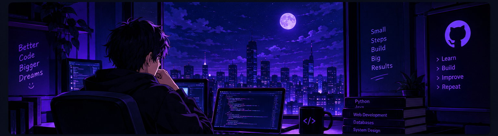

# Hey, I'm Hamza 👋

### Software Engineering Student | Aspiring Software Developer

I'm a Software Engineering student passionate about building software, solving problems, and understanding how things work behind the scenes.

Currently exploring **Backend Development, Full-Stack Engineering, and Artificial Intelligence**. I enjoy learning new technologies, experimenting with ideas, and turning what I learn into practical projects.

  

---

### 👨‍💻 About Me

- 🎓 Software Engineering student at COMSATS University Islamabad, Lahore Campus.
- 💻 Interested in Backend Development, Full-Stack Engineering, and Software Architecture.
- 🌱 Learning Java, Python, JavaScript, React, and FastAPI.
- ⚙️ Exploring REST APIs, database management, OOP, and software development principles.
- 🤖 Interested in Artificial Intelligence, RAG systems, and AI-powered applications.
- 🚀 Learning by building projects and experimenting with new technologies.
- 📚 Focused on understanding concepts rather than just writing code.

---

### 🛠️ Languages & Technologies

**Programming Languages**

  

**Frontend Development**

  

**Backend Development & Databases**

  

**Java Development**

- Java
- JavaFX
- JDBC
- Object-Oriented Programming (OOP)

**Tools & Development Environment**

  

**Currently Exploring**

- SQLAlchemy and database integration
- REST API development with FastAPI
- AI applications and Retrieval-Augmented Generation (RAG)
- MongoDB, Node.js, and Express.js
- Software Architecture and System Design

---

### 🚧 Currently Working On & Exploring

- **React & Frontend Development** — Strengthening my understanding of components, props, state, hooks, and layouts.
- **StockPilot** — Learning to build an Inventory and Order Management System using React, FastAPI, SQLAlchemy, and PostgreSQL.
- **Python & Backend Development** — Improving my programming fundamentals, OOP, API development, and database integration.
- **Dustoor AI** — Exploring AI-powered legal research, multi-turn RAG, and citation verification for Pakistani law.

*These are ongoing learning and development efforts.*

---

### 📈 GitHub Activity

  

  

---

### ⚡ Beyond the Keyboard

- ⚽ Occasionally hitting the football field for a game.
- 🏊‍♂️ An experienced swimmer who loves being in the water.
- 🏋️‍♂️ Into fitness, gym, and staying active.
- 🎮 Gaming enthusiast, especially PlayStation.
- 🍥 Anime, manga, and manhwa lover.
- 📚 Always curious about learning something new.

---

### 🎯 My Goal

My goal is to become a well-rounded software engineer with strong foundations in programming, backend development, databases, and system design.

I believe in learning the fundamentals, building things from scratch, making mistakes, and improving with every project.

**One project, one concept, and one step at a time.**

---

  Thanks for visiting my profile! Feel free to explore my repositories. ⭐

